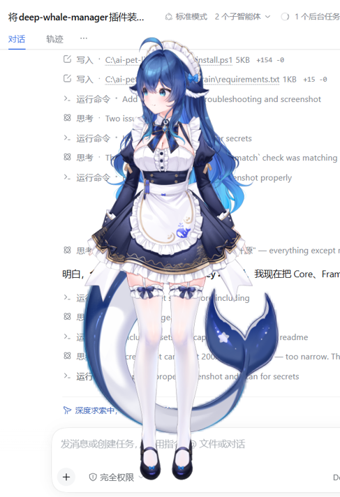

# 大肥鱼桌宠 · Dafeiyu Desktop Pet

> 一个跑在 Windows 上的 Live2D 桌面宠物：**能聊天、能听你说话、能帮你点屏幕**。
> 透明的独立窗口，无边框、不抢焦点，她只在你鼠标落到她身上时才接收点击。



---

## 它能做什么

| 能力 | 说明 |
|---|---|
| **陪聊** | 接你喜欢的任意 OpenAI 兼容接口（DeepSeek / GLM / OpenAI…），延迟 1~4 秒 |
| **语音对话** | 麦克风 → Silero VAD 切句 → SenseVoice 识别 → 模型回答 → edge-tts 念出来（带气泡） |
| **点屏幕 / 打字** | 说「帮我点右上角的按钮」，她会返回坐标并真的点下去 |
| **全屏漫游** | 打开后窗口铺满屏幕、背景全透明，她可以待在任意位置，拖动移动的是角色本身 |
| **跟随鼠标** | 头、眼睛、身体跟着你的鼠标转；摸她、点她会抖一下 + 音效 |
| **小动作** | 摇头 / 点头 / 歪头 / 晃身子 / 晃脑袋，待机时会自己来一个 |
| **设置界面** | 右键她 →「设置…」，界面里改 API、音色、音效、置顶、漫游 |

---

## 环境要求

* Windows 10 / 11（x64）
* **Node.js 18+**（装 `renderer` 依赖、构建页面）
* **Python 3.10+**（语音那一半）
* Live2D 的 **Cubism Core** 与**模型文件**（见下方「资源需要自备」）

---

## 安装

```powershell
git clone https://github.com/<你的账号>/dafeiyu-pet.git
cd dafeiyu-pet
pwsh -File install.ps1
```

脚本会依次：
1. 检查 Node / Python
2. 装 `renderer` 的 npm 依赖并构建页面
3. 建 `brain/.venv` 并装 Python 依赖
4. 检查 Cubism Core 与模型是否存在（缺了会告诉你放哪里）
5. 生成 `brain/voice_bridge.json` 配置模板

### 资源说明

**已随仓库提供**（开箱即用）：

| 内容 | 位置 | 备注 |
|---|---|---|
| Cubism Core | `renderer/public/Core/` | Live2D 专有文件，**仅限按 Live2D 协议使用** |
| Cubism Framework | `Framework/` | 同上 |
| 模型「大肥鱼」 | `renderer/public/Resources/大肥鱼/` | 本项目自带；换模型见下 |

**需要自备**：

| 需要什么 | 放到哪 | 从哪来 |
|---|---|---|
| 你自己的 Live2D 模型（可选） | `renderer/public/Resources/<模型名>/` | 自己制作 / 购买，注意模型使用条款 |
| SenseVoice 语音模型 | `~/.dsh/speech-to-text/sensevoice/models/` | [sherpa-onnx 模型库](https://github.com/k2-fsa/sherpa-onnx/releases) |

> 官方示例模型（Haru / Hiyori / Mao…）**没有**放进仓库：
> 它们属于 Live2D 的示例资源，公开再分发有授权风险。需要的话自己去官方 SDK 里取。

不想用语音？可以只跑聊天和点击 —— 见下方「最小可用配置」。

---

## 启动

```powershell
# 只启动桌宠窗口（聊天 + 点击）
node app/main.js --model 你的模型名 --w 520 --h 760

# 再启动语音（另开一个窗口）
cd brain
.\.venv\Scripts\python.exe voice_bridge.py
```

想开机自启，可以把上面两条包成快捷方式放进「启动」文件夹，或用 `schtasks` 建计划任务。

---

## 配置

### 方式一：界面（推荐）

**右键点她 →「设置…」**：

* **大脑 / API**：接口地址、模型名、API Key、音色
* **外观 / 行为**：触摸音效开关、音量、置顶、全屏漫游
* 保存后 API 配置**立即生效**（不需要重启）

界面里填的 API 会写进 `brain/voice_bridge.json`；界面配置写在 `app/pet-settings.json`。

### 方式二：直接改 `brain/voice_bridge.json`

```json
{
  "brain_mode": "api",
  "llm": {
    "base_url": "https://api.deepseek.com",
    "model": "deepseek-flash",
    "api_key": "<你的 API Key>"
  },
  "context_turns": 3,
  "ocr_max_lines": 16
}
```

> 模型名要填**接口的模型 ID**（如 `deepseek-flash`），不是界面上显示的名字。

### 最小可用配置（不带语音）

只想聊天 + 点屏幕：

```json
{
  "brain_mode": "api",
  "llm": { "base_url": "https://api.deepseek.com", "model": "deepseek-flash", "api_key": "<你的 API Key>" }
}
```

然后只启动 `node app/main.js --model 你的模型名`。

---

## 目录结构

```
app/                Electron 外壳（窗口、几何、命中检测、设置界面、HTTP API）
  main.js           启动装配 + 本地 API（:5011）
  shell/            职责拆分：windowState（几何唯一真相）/ pageCommand / settingsStore…
  settings.html     设置界面
renderer/           Live2D 页面
  src/pet/          pose（姿态唯一写者）/ modelFit（矩阵唯一写者）/ sfx / commandBus
  src/interact.ts   鼠标、拖动、缩放、气泡、表情
brain/              Python：语音与大脑
  voice_bridge.py   麦克风 → VAD → ASR → 模型 → TTS
  pet_llm.py        直连 OpenAI 兼容接口
  pet_voice.py      edge-tts 合成与播放
  desktop_tool.py   键鼠模拟 / OCR / 窗口操作
tests/              回归测试（见下）
scripts/            verify.ps1 一键验收 / check-rules.mjs 结构门禁
docs/               架构与排查
```

---

## 测试

```powershell
pwsh -File scripts/verify.ps1          # 一键验收（类型检查 + 单测 + 24 项集成回归）
pwsh -File scripts/verify.ps1 -Fast    # 跳过需要桌宠在跑的集成测试

node --test                            # JS 单元测试（几何、姿态）
python tests/test_regressions.py       # 24 项端到端回归
```

这套回归覆盖了开发过程中**真实踩过并修过**的问题：窗口越拖越大、缩放漂移、
半边身子被切、点击穿透失效、设置窗口关不掉、同一句话重复回答、语音桥卡死等。
每条都写在 `tests/test_regressions.py` 里，注释里说明它守的是哪个 bug。

---

## 常见问题

**她听不懂我说话**
看 `brain/voice_bridge.log`：
* `听到：'...'` → 识别到了
* `（x 秒片段电平 0.00xx < 0.00xx，判定噪声丢弃）` → 电平门限判定为噪声，换个安静环境或说话大声一点
* `心跳：麦克风峰值 0.0000` → 麦克风没在收声，检查设备

**她周围的东西点不了**
托盘菜单里「整窗吞鼠标」被打开了（排障用）。关掉即可；它也会 60 秒自动恢复。

**她不动 / 卡住**
先看窗口右上角是否正常显示。若模型静止，说明页面在重扫适配，
等 3 秒；一直不动就重启。

**API 报 400**
多半是模型名不对。DeepSeek 只认 `deepseek-flash` / `deepseek-v4-pro`。

更多见 [docs/TROUBLESHOOTING.md](docs/TROUBLESHOOTING.md)。

---

## 许可证与第三方

* **本项目代码**：MIT（见 [LICENSE](LICENSE)）
* **Live2D Cubism SDK / Core**：Live2D 专有许可，**不随本仓库分发**，请自行下载并遵守其协议
* **官方 Sample 模型**（Haru / Hiyori / Mao / Natori / Rice / Wanko…）：同样不随仓库分发
* **SenseVoice / Silero / sherpa-onnx**：各自的开源许可
* 详见 [THIRD-PARTY.md](THIRD-PARTY.md)

---

## 致谢

* [Live2D Cubism SDK for Web](https://www.live2d.com/sdk/cubism/) —— 渲染
* [sherpa-onnx](https://github.com/k2-fsa/sherpa-onnx) —— ASR / VAD
* [edge-tts](https://github.com/rany2/edge-tts) —— 语音合成
* 灵感来自各路桌面宠物（Shimeji 等）
